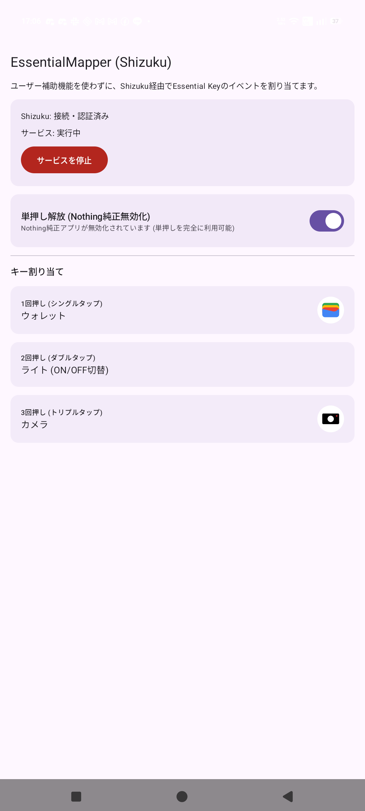

# EssentialMapper (Shizuku)

[English](README.md) | [日本語](README.ja.md)

[tracpants/essential-mapper](https://github.com/tracpants/essential-mapper) をベースに、Shizuku連携に対応させたフォーク版です。

Nothing Phone (3a) Lite のハードウェアキー **「Essential Key」** をリマップし、タップ回数（1回・2回・3回）に応じて任意のアプリ起動やフラッシュライトのON/OFF切り替えを行えるようにします。

<p align="center">
  
</p>

デフォルトの割り当て：**1回押し → Claude · 2回押し → Google ウォレット · 3回押し → フラッシュライト切り替え**（アプリ内から自由に変更可能）。

## 本フォーク版の主な変更点

- **ユーザー補助（Accessibility Service）の完全撤廃（決済・金融アプリ対策）**:  
  Androidのユーザー補助機能への依存を完全に排除しました。PayPayや各種銀行系アプリなどは、セキュリティ対策としてユーザー補助機能が有効になっていると起動を拒否したり警告を表示します。本フォークでは [Shizuku](https://shizuku.rikka.app/) を利用した標準のフォアグラウンドサービスとして動作するため、それらの制限に一切干渉しません。
- **アプリ内からの「単押し解放」**:  
  Nothing純正の Essential アプリ群の無効化を、PCや手動ADBコマンドを使わず、アプリ内の「単押し解放」スイッチからワンタップで切り替え可能です。
- **独立したパッケージID**:  
  `com.aiden.essentialmapper.shizuku` としてビルドされているため、オリジナルの EssentialMapper と同じ端末上で共存・テスト可能です。
- **日英多言語対応**:  
  端末の言語設定（日本語 / 英語）に合わせてUIが自動的に切り替わります。

## 動作要件 ＆ セットアップ

1. **Shizuku**: 端末上で [Shizuku](https://shizuku.rikka.app/) が起動していること（ワイヤレスデバッグまたはルート権限）。
2. APKをインストールし、**EssentialMapper (Shizuku)** を起動します。
3. 画面の案内に従ってShizukuの権限を許可し、監視サービスを開始します。

## 単押しの解放について

2回押し・3回押しはインストール直後から動作します。**1回押し（シングルタップ）** は、Nothing純正の Essential アプリ群を無効化するまでシステム側に奪われます。

本フォーク版では、アプリ内の **「単押し解放 (Nothing純正無効化)」** スイッチをONにするだけで（Shizuku経由で）簡単に解放・復元できます。

手動でADBから無効化・有効化したい場合は以下のコマンドでも実行可能です：

```bash
adb shell pm disable-user --user 0 com.nothing.ntessentialspace
adb shell pm disable-user --user 0 com.nothing.ntessentialrecorder
adb shell pm disable-user --user 0 com.nothing.essentialintelligence
```

## 仕組み（How it works）

Androidの `AccessibilityService.onKeyEvent` をフックする代わりに、本フォーク版はShizuku経由で `/dev/input/event0` から `getevent` コマンドを実行し、Linuxカーネルの入力イベントを直接読み取ります。

Essential Keyのハードウェアイベントコード `00fa`（16進数、10進数で **scanCode 250**。`keyCode=0` と報告されるため、scanCodeが唯一の安定した識別子です）を監視します。400ミリ秒のデバウンス時間でタップ回数をカウントし、DataStoreに保存された設定に基づいてアプリを起動します。

> ⚠️ scanCode 250 はこの端末およびファームウェア固有のものです（他のNothingモデルでの動作は保証されません）。

## クレジット

- オリジナルプロジェクト: [Aiden Rudolph (@tracpants)](https://github.com/tracpants/essential-mapper)
- ADBによる純正機能無効化のアイデア: [z3phydev 氏のガイド](https://github.com/z3phydev/How-to-remap-or-disable-the-Essential-Key)
- キー傍受の設計思想: [Key Mapper](https://github.com/keymapperorg/KeyMapper)

## ライセンス

[MIT](LICENSE) © 2026 Aiden Rudolph / Contributors. Not affiliated with Nothing.
