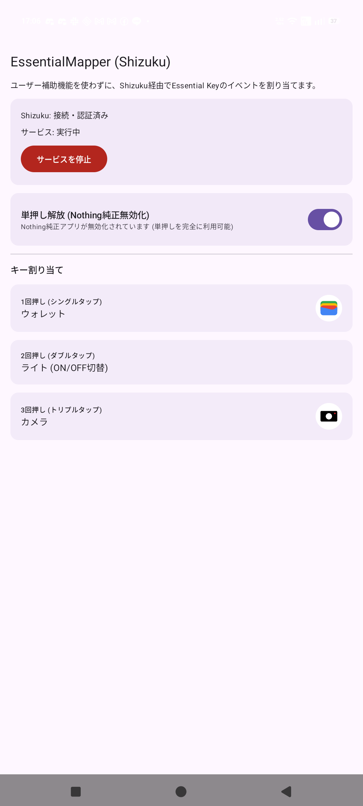

# EssentialMapper (Shizuku)

This is a Shizuku-powered fork of [tracpants/essential-mapper](https://github.com/tracpants/essential-mapper).

Remap the Nothing Phone (3a) Lite's hardware **Essential Key** to launch an app or
toggle the flashlight by tap count — single, double, or triple.

<p align="center">
  
</p>

Default mapping is **single → Claude · double → Wallet · triple → flashlight**; change any
slot in the app.

## Key Changes in this Fork

- **Shizuku-Powered**: Instead of relying solely on the Android Accessibility Service, this fork uses [Shizuku](https://shizuku.rikka.app/) to monitor hardware key events directly and run as a foreground service.
- **Independent Package**: Packaged as `com.aiden.essentialmapper.shizuku` so it can be installed alongside the original app.

## Requirements & Setup

1. **Shizuku**: Make sure [Shizuku](https://shizuku.rikka.app/) is running on your device (via Wireless Debugging or Root).
2. Install the APK and launch **EssentialMapper (Shizuku)**.
3. Grant Shizuku permission when prompted, then start the monitoring service.

## Freeing the single press

Double- and triple-tap work immediately. The **single** press stays system-owned until you
disable Nothing's Essential surfaces (reversible with `pm enable`):

```bash
adb shell pm disable-user --user 0 com.nothing.ntessentialspace
adb shell pm disable-user --user 0 com.nothing.ntessentialrecorder
adb shell pm disable-user --user 0 com.nothing.essentialintelligence
```

## How it works

Key events are monitored by matching the Essential Key **scanCode 250** (it reports `keyCode=0`, so the scanCode is its only stable identity). Taps are counted on a 400 ms debounce and dispatched from a DataStore-backed map. Both tunables live in `EssentialKeyService`.

> ⚠️ scanCode 250 is specific to this device/firmware — no promise it matches other Nothing models.

## Credits

- Original project by [Aiden Rudolph (@tracpants)](https://github.com/tracpants/essential-mapper).
- The ADB trick comes from [z3phydev's guide](https://github.com/z3phydev/How-to-remap-or-disable-the-Essential-Key).
- Interception approach mirrors [Key Mapper](https://github.com/keymapperorg/KeyMapper).

## License

[MIT](LICENSE) © 2026 Aiden Rudolph / Contributors. Not affiliated with Nothing.
